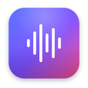

# OpenFaders branding

The OpenFaders mark is a six-bar white waveform on a blue-violet-pink gradient
tile. It comes in three variants. Every variant is available as SVG and as PNG in
eight sizes.

| Variant | Use it for | Preview |
|---|---|---|
| **Logo** | Websites, docs, READMEs, press: anywhere the mark sits on its own |  |
| **Avatar** | Profile pictures (GitHub, Discord, social accounts). Square, full-bleed, no rounded corners, so the platform can apply its own crop or corner radius |  |
| **Icon** | The macOS app icon as it ships, with the standard margin and drop shadow. Use it where an app icon is expected, such as a download page next to the app name |  |

## Files

- SVG: [svg/openfaders-logo.svg](svg/openfaders-logo.svg),
  [svg/openfaders-avatar.svg](svg/openfaders-avatar.svg),
  [svg/openfaders-icon.svg](svg/openfaders-icon.svg)
- PNG: `png/openfaders-<variant>-<size>.png` for each size of 16, 32, 64, 128,
  256, 512, 1024 and 2048 px. The logo and the icon have a transparent
  background. The avatar is opaque.

Prefer the SVG wherever the target accepts it.

## Colors

| Role | Value |
|---|---|
| Gradient start (top left) | `#4F6BFF` |
| Gradient middle | `#7B4DFF` |
| Gradient end (bottom right) | `#FF4D8D` |
| Waveform | `#FFFFFF` |

The tile also has a soft white highlight at the top and a light shade at the
bottom. The SVG files hold the exact values.

## Usage

- Keep the waveform white and the gradient as it is. Do not recolor, rotate or
  stretch the mark.
- The name is written **OpenFaders**: one word, capital O and F.

## Regenerating

The sources are in `Design/` at the repository root: `AppIcon.svg`, `Logo.svg`
and `Avatar.svg`. All three share the same geometry. After you change one, run
the export script and commit the result:

```sh
Scripts/export-branding.sh
```

It needs Google Chrome (for rendering) and ImageMagick (for scaling).
